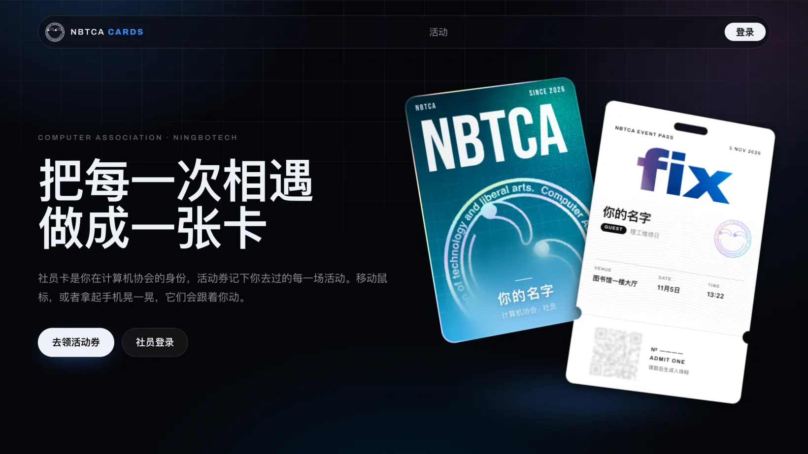
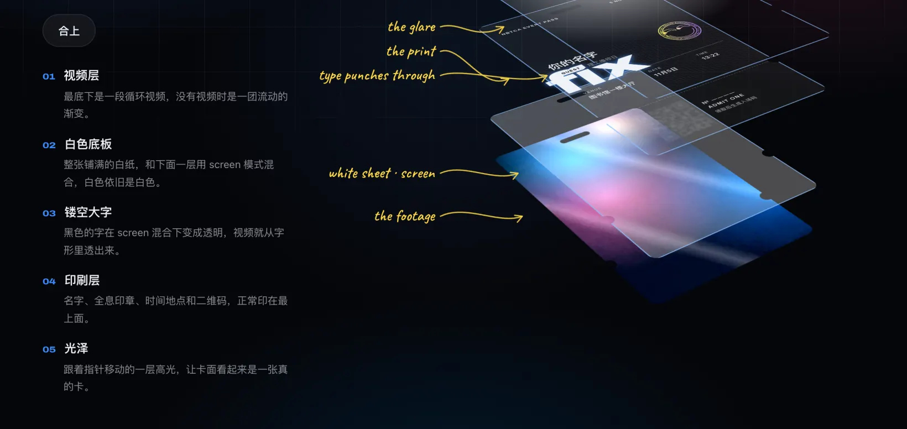

<div align="center">

<h1>NBTCA Cards</h1>

<p>Member ID cards and event passes for the Computer Association of NingboTech University.</p>

<p>
  <a href="https://card.nbtca.space"></a>
  <a href="https://github.com/nbtca/card/actions/workflows/ci.yml"></a>
</p>



</div>

## Highlights

- **Cards that feel like objects.** They tilt with the pointer or the phone, drift apart in layers, and catch foil only when they lean.
- **Footage through type.** An event pass plays its video through the letters of one large word.
- **Check-in at the door.** Peel the sticker to reveal the QR code; when staff scan it, the stub tears off and the event's stamp lands on the pass and on the back of the member card.
- **On the badge.** Members save their card as a round 360 px wallpaper for [CABadge](https://github.com/nbtca/CABadge).
- **Repair tags.** `/r/<id>` shows a repair ticket from [Saturday](https://github.com/nbtca/Saturday) as a tag that gets punched at each step and loses its stub when the repair is done. Events marked as repair days count the tickets opened while they run, on the event page and the entry wall. Member pages and the yearly recap show the repairs each member took on, matched by their NBTCA username.
- **Course credit.** An event can collect validated student details and export them as CSV.
- **Light on devices and on D1.** Effects animate only `translate` and `opacity`, and pages read a handful of indexed rows.

## How a pass is built



A pass stacks footage, a white sheet, a black word, the print and a glare. The sheet and the word blend with `mix-blend-mode: screen`, so white stays white and black turns clear, and the footage shows only through the letters.

| Effect | How |
| --- | --- |
| Tilt and parallax | `tilt.ts` writes `--x` and `--y` from pointer or device orientation; layers translate by different amounts |
| Foil | A rainbow band slides under a fixed mask, so tilting repaints nothing |
| Lanyard | A damped spring drawn as an SVG strap, which sleeps once the pass rests |
| Peel and tear | `peel.ts` folds the sticker along the pointer; `ticket.ts` tears the stub after a scan |
| Member wall | `pluck.ts` lets a card be pulled out, thrown and sprung back into its slot |
| Stamps | `Stamp.astro` draws each event's seal in one ink, turned by the pass id; a fixed noise image masks the ink, so no filter runs while cards tilt |
| Sound | Synthesised with Web Audio in `sound.ts`, only after the visitor interacts |

## Who can do what

| Who | Can |
| --- | --- |
| Anyone | See events |
| Anyone signed in | Claim one pass per event |
| Logto roles in `MEMBER_ROLES` | See every member card, edit their own at `/me`, start and edit events, check in passes at `/scan` |
| Logto roles in `ADMIN_ROLES` | Everything members can, and edit any event |

A member's card appears after their first visit. Name and alias follow their Logto account. Portraits and backgrounds are framed in a 5:7 window, re-encoded in the browser to WebP, and served only to members.

## Event lifecycle

1. A member creates an event with a claim window, start and end time, venue, capacity and an optional loop of up to 15 seconds and 10 MB.
2. Visitors claim a pass inside the window. If the event asks for course credit, they also give their name, student ID, class and phone.
3. From an hour before the start, the sticker peels to show the code. Before that the page does not contain the code, so a screenshot carries nothing.
4. Staff scan `https://card.nbtca.space/scan#<pass id>` at `/scan` or with the phone's camera. A pass checks in once.
5. Once the sticker is peeled, the pass page checks every few seconds and tears the stub off after the scan.
6. While the event is on, members who are in see a code on the event page. Another member who is in scans it with their camera, and each of them sees on the other's card where they met.
7. The torn pass joins the holder's stubs on `/me` and their member page.
8. The creator exports everyone, or only those who checked in, as a CSV that keeps leading digits in Excel.

Student IDs must match `[23]` + entry year + 4-digit major + 3-digit number, and one ID holds one pass per event. This rules out typos and invented numbers, not borrowed IDs.

## Designing a pass

Each `.astro` file in `src/cards/passes/` is a design, named after the file and listed in the event editor. It receives `PassProps` from `src/cards/pass.ts`, whose `ticket()` supplies the dates, serial, check-in state and QR path. Mark elements with `data-bind` for live preview in the editor. Events whose design file is missing fall back to `default`. `/dev/passes` shows every design in each state a pass goes through, from preview to torn, along with a sheet of sample stamps. Propose a new design with the [券面设计投稿](https://github.com/nbtca/card/issues/new?template=pass-design.yml) issue form.

## Project structure

```
src/
  cards/       MemberCard, passes/, Lanyard, and the tilt, peel, ticket and pluck scripts
  components/  event editor and list
  lib/         Access verification, D1 queries, validation, cropping, sound
  pages/       routes, including api/ and media/
  middleware.ts
migrations/    D1 schema, applied in order on deploy
public/        fonts and the default footage
```

## Deploy

Requires a Cloudflare account with Workers, D1, R2 and Zero Trust.

1. In Zero Trust, add a self-hosted application on `card.nbtca.space` for the paths `/login`, `/members`, `/me`, `/scan`, `/api` and `/media/members`, with Logto as the only identity provider and instant authentication on. Pass the `roles`, `name`, `username` and `picture` OIDC claims. Put the Application Audience tag in `ACCESS_AUD` in `wrangler.jsonc`.
2. Create the storage and copy the D1 ID into `wrangler.jsonc`:

   ```sh
   wrangler d1 create card
   wrangler r2 bucket create card-media --location apac
   ```

3. Run `pnpm run deploy`, which builds, applies migrations and deploys. Plain `pnpm deploy` is a different pnpm command.

Event pages stay public; the Worker reads the same `CF_Authorization` cookie there to show a signed-in visitor their pass.

CI checks every pull request and deploys every push to `main`. The `production` environment needs a `CLOUDFLARE_API_TOKEN` with Workers Scripts, D1 and Workers R2 Storage edit rights on the account, and Workers Routes edit on the `nbtca.space` zone. Migrations run before the new code, so each must work with the previous release.

> [!IMPORTANT]
> The account shares the [D1 free tier](https://developers.cloudflare.com/d1/platform/limits/) of 5 million rows read per day with other NBTCA services. Keep queries indexed. When the limit is hit, pages show an outage notice until 00:00 UTC.

## Development

```sh
pnpm install
pnpm preview     # production build on local workerd with local D1 and R2
pnpm typecheck
pnpm test        # unit tests with node:test
```

Access does not run locally. To test signed-in pages, serve a JWKS from a local issuer, start `wrangler dev --var ACCESS_TEAM_DOMAIN:<issuer> --var ACCESS_AUD:<aud>`, and send RS256 tokens it signed in the `CF_Authorization` cookie.

## Credits

- Layered parallax and progressive blur from [osaka-card](https://github.com/jh3y/osaka-card), and video through type from the [knockout video card](https://www.jhey.dev/prototypes/2026/knockout-video-card/), both by Jhey Tompkins.
- Holographic foil after [pokemon-cards-css](https://github.com/simeydotme/pokemon-cards-css).
- [Bebas Neue](https://github.com/dharmatype/Bebas-Neue), [Archivo](https://github.com/Omnibus-Type/Archivo) and [Caveat](https://github.com/googlefonts/caveat), under the [SIL Open Font License 1.1](https://openfontlicense.org).
